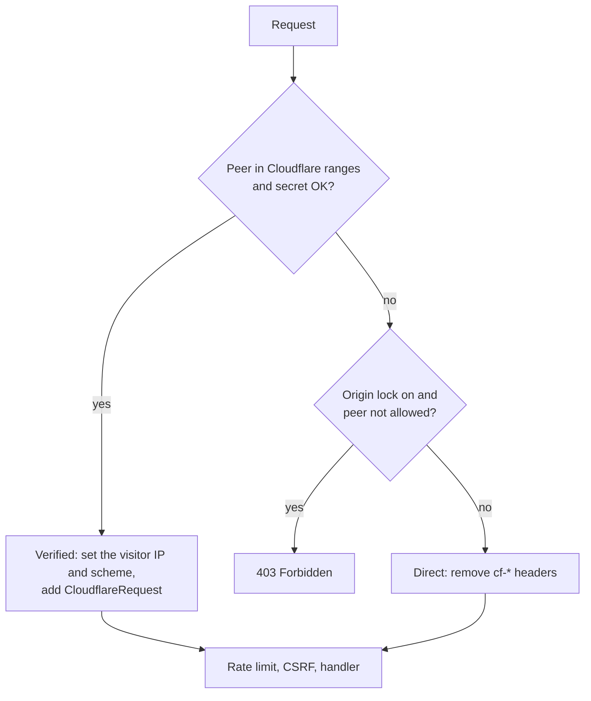

# autumn-plugin-cloudflare

Run an [Autumn](https://autumn-web.app) (`autumn-web` 0.8) application
behind Cloudflare. Add one line. Autumn then uses the real visitor IP.

```rust
use autumn_plugin_cloudflare::CloudflarePlugin;
use autumn_web::prelude::*;

#[get("/hello")]
async fn hello(addr: autumn_web::extract::ClientAddr) -> String {
    format!("hello {}", addr.ip())
}

#[autumn_web::main]
async fn main() {
    autumn_web::app()
        .plugin(CloudflarePlugin::new())
        .routes(routes![hello])
        .run()
        .await;
}
```

## What it does

- **Real client IP.** For a request from a Cloudflare edge, `ClientAddr`,
  rate limits, and other Autumn features use the visitor IP from
  `CF-Connecting-IP`.
- **Anti-spoofing.** For a request from another peer, the plugin removes
  all `cf-*` headers and `true-client-ip`.
- **Origin lock.** Optional. Return `403` to peers that are not
  Cloudflare.
- **Shared secret.** Optional. Require a header that a Cloudflare
  Transform Rule adds.
- **Cloudflare data.** The `CloudflareRequest` extractor gives the Ray
  ID, country, scheme, and Worker zone.
- **Cache tags and purge.** `CacheTags` adds a `Cache-Tag` header.
  `CloudflareCache` purges URLs, tags, prefixes, hosts, or everything.

Autumn core already has Turnstile, R2 storage, and Cloudflare DNS-01.
This plugin does not repeat them.

## Why not only `[security.trusted_proxies]`?

You can put the Cloudflare ranges in `[security.trusted_proxies]`. Then
Autumn reads `X-Forwarded-For` from the right and skips Cloudflare IPs.
But a Cloudflare Worker sends requests from a Cloudflare IP. Autumn
skips that IP too, and uses the next entry. The caller controls that
entry. The plugin uses `CF-Connecting-IP`, which Cloudflare always
overwrites.

## How it works

The plugin adds one layer with `AppBuilder::layer`. The layer runs
before rate limits, CSRF, bot protection, maintenance mode, and the
handlers.



See [ADR 0001](docs/adr/0001-identity-layer.md) for the reasons.

## Install

```toml
[dependencies]
autumn-plugin-cloudflare = "0.1"
```

## Options

| Method | Default | Effect |
|---|---|---|
| `ranges(CloudflareRanges)` | built-in list | The Cloudflare edge ranges. The built-in list is the published list on 2026-10-11. |
| `peer_source(PeerSource)` | `Socket` | `Socket`: check the TCP peer. `Resolved`: check the IP that Autumn resolved. Use `Resolved` when a load balancer is between Cloudflare and Autumn. Then put the load balancer in `[security.trusted_proxies]`. |
| `lock_origin(bool)` | `false` | `true`: return `403` to peers that are not Cloudflare. |
| `allow(IpRange)` | none | Peers in this range pass the origin lock, for example health checks. The plugin removes their `cf-*` headers. |
| `require_header(name, value)` | none | A request is from Cloudflare only if the header has this value. The plugin compares in constant time and removes the header. An empty value never matches. |
| `refresh_ranges(Duration)` | off | Get the ranges from the Cloudflare API at startup and at each interval (60 seconds or more). The plugin rejects unsafe lists and keeps the last good list. |
| `ranges_url(url)` | `https://api.cloudflare.com/client/v4/ips` | The range API URL. |
| `cache(CloudflareCache)` | none | Put a purge client in the app state. Handlers can then extract `CloudflareCache`. |

### Shared secret

Another Cloudflare account can point its own zone at your origin IP.
Its requests come from real Cloudflare IPs. To stop this, add a request
header with a Transform Rule in your zone, and require it:

```rust
use autumn_plugin_cloudflare::CloudflarePlugin;
use http::HeaderName;

let plugin = CloudflarePlugin::new()
    .require_header(HeaderName::from_static("x-origin-auth"), std::env::var("ORIGIN_SECRET").unwrap_or_default())
    .lock_origin(true);
```

## Behavior

- **Client IP.** The plugin uses `CF-Connecting-IPv6` when it holds a
  valid IPv6 address (Pseudo IPv4 "Overwrite Headers" mode). Then it
  uses `CF-Connecting-IP`. If the header is missing, repeated, or not
  valid, the plugin uses the edge IP.
- **Scheme.** `ClientScheme` comes from `CF-Visitor`, then
  `X-Forwarded-Proto`. The plugin accepts only `http` and `https`.
- **Peer and forwarded headers.** For a verified request, the plugin
  sets `ConnectInfo` and `X-Forwarded-For` to the visitor IP, and
  removes `X-Real-IP`. The Autumn rate limiter reads these values again.
  `CloudflareRequest::edge_ip` gives the edge IP.
- **IPv4-mapped peers.** When Autumn listens on `[::]`, IPv4 peers have
  the form `::ffff:a.b.c.d`. The plugin checks them as IPv4.
- **Range safety.** A range list must not be empty. No range can be
  broader than `/8` (IPv4) or `/16` (IPv6).
- **Access log.** The Autumn access log, metrics, and tenancy run before
  the plugin. They show the edge IP. Use `CloudflareRequest::ray` to
  match your logs with Cloudflare logs. Do not set
  `trust_forwarded_headers = true` only for Cloudflare: a client can
  send `X-Forwarded-Host` through Cloudflare.

## Cloudflare data

```rust
use autumn_plugin_cloudflare::CloudflareRequest;
use autumn_web::prelude::*;

#[get("/where")]
async fn where_from(cf: Option<CloudflareRequest>) -> String {
    match cf {
        Some(cf) => format!("{} from {:?}", cf.client_ip(), cf.country()),
        None => "not through Cloudflare".to_owned(),
    }
}
```

`CloudflareRequest` (not in an `Option`) returns `403` for a request
that did not come through Cloudflare.

## Cache tags and purge

```rust
use autumn_plugin_cloudflare::{CacheTags, CloudflareCache};
use autumn_web::prelude::*;

#[get("/posts/{id}")]
async fn show(Path(id): Path<u32>) -> impl axum::response::IntoResponse {
    let tags = CacheTags::new([format!("post:{id}"), "posts".to_owned()]).expect("valid tags");
    (tags, format!("post {id}"))
}

#[post("/posts/{id}/publish")]
async fn publish(cache: CloudflareCache, Path(id): Path<u32>) -> &'static str {
    let _ = cache.purge_tags([format!("post:{id}")]).await;
    "ok"
}
```

Make the client with `CloudflareCache::new(zone_id, ApiToken::new(token)?)`
or `CloudflareCache::from_env()` (`CLOUDFLARE_ZONE_ID`,
`CLOUDFLARE_API_TOKEN`). The token needs the "Cache Purge" permission.

- A tag has 1 to 1,024 bytes of printable ASCII, with no space and no
  comma. The full header value is 16 KB or less.
- The client sends batches of 100 items or less (`batch_size` sets
  fewer). It does not retry. On an error, `PurgeError::purged()` gives
  the number of purged items. A `429` gives `PurgeError::RateLimited`
  with the `Retry-After` time.
- `Debug` output never shows the token.

## Example

`examples/hello.rs` is a full app. To try it on your computer, make
loopback a "Cloudflare" range:

```sh
CLOUDFLARE_RANGES=127.0.0.0/8 cargo run --example hello
curl -H 'cf-connecting-ip: 203.0.113.7' http://127.0.0.1:3000/whoami
```

## Development

| Task | Command |
|---|---|
| Format | `cargo fmt` |
| Lint | `cargo clippy --all-targets -- -D warnings` |
| Docs | `RUSTDOCFLAGS="-D warnings" cargo doc --no-deps` |
| Test | `cargo test` |
| Coverage | `cargo llvm-cov --summary-only` |
| Proofs | `VERUS=/path/to/verus verification/verify.sh` |

To use the pre-commit hook, type `git config core.hooksPath .githooks`.

`verification/core.rs` has Verus proofs for the pure core.
`tests/spec_conformance.rs` checks that the runtime code agrees with the
model. The planning notes are in [docs/planning.md](docs/planning.md).

## License

Apache-2.0. See [LICENSE](LICENSE).
