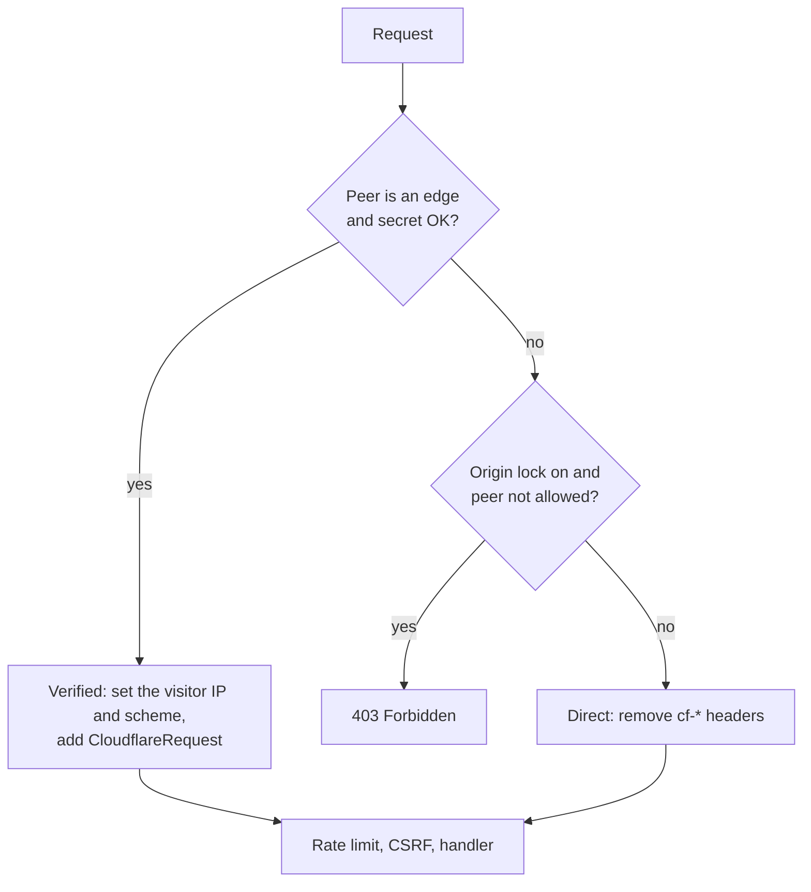

# autumn-plugin-cloudflare

Run an [Autumn](https://autumn-web.app) (`autumn-web` 0.8) application
behind Cloudflare. Add one line. Autumn then uses the visitor IP.

```rust,no_run
use autumn_plugin_cloudflare::CloudflarePlugin;
use autumn_web::prelude::*;

#[get("/hello")]
async fn hello(addr: autumn_web::extract::ClientAddr) -> String {
    format!("hello {}", addr.ip())
}

#[autumn_web::main]
async fn main() {
    autumn_web::app()
        .plugin(CloudflarePlugin::new())
        .routes(routes![hello])
        .run()
        .await;
}
```

## Terms

- **Edge:** a Cloudflare server. Its IP is in the Cloudflare ranges.
- **Visitor IP:** the IP of the client that connected to Cloudflare.
- **Verified request:** a request from an edge (with the shared secret,
  if you set one). All other requests are **direct**.

## What it does

- **Visitor IP.** For a verified request, `ClientAddr`, rate limits, and
  maintenance allow lists use the visitor IP from `CF-Connecting-IP`.
- **Anti-spoofing.** For a direct request, the plugin removes all `cf-*`
  headers and `true-client-ip`.
- **Origin lock.** Optional. The plugin returns `403` for direct
  requests.
- **Shared secret.** Optional. The plugin verifies a request only when
  it has a header that a Cloudflare Transform Rule adds.
- **Cloudflare data.** The `CloudflareRequest` extractor gives the Ray
  ID, country, scheme, and Worker zone.
- **Cache tags and purge.** `CacheTags` adds a `Cache-Tag` header.
  `CloudflareCache` purges URLs, tags, prefixes, hosts, or everything.

Autumn core already has Turnstile, R2 storage, and Cloudflare DNS-01.
This plugin does not repeat them.

## Why not only `[security.trusted_proxies]`?

You can put the Cloudflare ranges in `[security.trusted_proxies]`. Then
Autumn reads `X-Forwarded-For` from the right and skips edge IPs. But a
Cloudflare Worker sends requests from an edge IP. Autumn skips that IP
too, and uses the next entry. The client controls that entry. The plugin
uses `CF-Connecting-IP`. Cloudflare always overwrites this header.

## How it works

The plugin adds one layer with `AppBuilder::layer`. The layer runs
before rate limits, CSRF, maintenance mode, and the handlers.



See [ADR 0001](docs/adr/0001-identity-layer.md) for the reasons.

## Install

```toml
[dependencies]
autumn-plugin-cloudflare = "0.1"
```

The public API uses types from `http` 1, `axum` 0.8, and `tower` 0.5. A
new major version of one of these crates changes this API.

## Options

| Method | Default | Effect |
|---|---|---|
| `ranges(CloudflareRanges)` | built-in list | The edge ranges. The built-in list is the published list on 2026-10-11. A range refresh replaces this list. |
| `peer_source(PeerSource)` | `Socket` | `Socket`: check the TCP peer. `Resolved`: check the IP that Autumn resolved. See "Load balancer" below. |
| `lock_origin(bool)` | `false` | `true`: return `403` for direct requests. |
| `allow(IpRange)` | none | Peers in this range pass the origin lock. Use it for health checks. The plugin removes their `cf-*` headers. The plugin does not check the width of the range, so `0.0.0.0/0` turns the lock off. |
| `require_header(name, value)` | none | The plugin verifies a request only when the header has this value. The plugin compares in constant time and removes the header. An empty value never matches. |
| `refresh_ranges(Duration)` | off | Get the ranges from the range API at startup and at each interval. If the interval is less than 60 seconds, the plugin uses 60 seconds. |
| `ranges_url(url)` | `https://api.cloudflare.com/client/v4/ips` | The range API URL. It must use `https`. Only a loopback host can use `http`. |
| `cache(CloudflareCache)` | none | Put a purge client in the app state. Handlers can then extract `CloudflareCache`. |

### Shared secret

Another Cloudflare account can point its own zone at your origin IP.
Its requests come from real edges. To stop this, add a request header
with a Transform Rule in your zone. Then require it:

```rust,no_run
use autumn_plugin_cloudflare::{CloudflarePlugin, HeaderName};

fn plugin() -> CloudflarePlugin {
    let secret = std::env::var("ORIGIN_SECRET").expect("ORIGIN_SECRET is set");
    CloudflarePlugin::new()
        .require_header(HeaderName::from_static("x-origin-auth"), secret)
        .lock_origin(true)
}
```

### Range refresh

With `refresh_ranges`, the first request runs after startup. Until it
completes, the plugin uses the list from `ranges` (or the built-in
list). A good answer then replaces that list. The plugin rejects a list
that:

- is empty, or has more than 1,024 ranges;
- has a range broader than `/8` (IPv4) or `/16` (IPv6);
- covers more than one `/8` (IPv4) or one `/16` (IPv6) in total;
- touches private, loopback, link-local, or shared (CGNAT) addresses.

After a failure, the plugin logs a warning and keeps the last good list.
In Autumn task mode (`AUTUMN_RUN_TASK`), the plugin does not refresh.

### Load balancer

Use `PeerSource::Resolved` when a load balancer is between Cloudflare
and the app. Then configure Autumn like this:

```toml
[security.trusted_proxies]
trust_forwarded_headers = true
ranges = ["10.0.0.0/24"] # the load balancer only
```

- Put only the load balancer in `ranges`. Do not put Cloudflare ranges
  there. If you do, a Worker can set the visitor IP.
- Do not set `trusted_hops`.
- For a verified request, the plugin takes the host from `Host` and
  removes `X-Forwarded-Host`. Direct requests keep the Autumn host.

## Behavior

- **Visitor IP.** The plugin reads `CF-Connecting-IP`. In Pseudo IPv4
  "Overwrite Headers" mode, that header holds a Class E address
  (`240.0.0.0/4`). Then the plugin uses `CF-Connecting-IPv6`. If
  `CF-Connecting-IP` is missing, repeated, or not valid, the plugin uses
  the edge IP. All such requests from one edge then share one rate-limit
  bucket.
- **Scheme.** `ClientScheme` comes from `CF-Visitor`. If that header is
  not valid, it comes from `X-Forwarded-Proto`. The plugin accepts only
  `http` and `https`.
- **Peer and forwarded headers.** For a verified request, the plugin
  sets `ConnectInfo` and `X-Forwarded-For` to the visitor IP. It removes
  `X-Real-IP`, `X-Forwarded-Host`, and `Forwarded`. The Autumn rate
  limiter reads the peer and `X-Forwarded-For` again.
  `CloudflareRequest::edge_ip` gives the edge IP.
- **IPv4-mapped peers.** When Autumn listens on `[::]`, IPv4 peers have
  the form `::ffff:a.b.c.d`. The plugin checks them as IPv4.

## Limits

- **Access log, metrics, tenancy, and method override.** These Autumn
  layers run outside the plugin. They show the edge IP. Use
  `CloudflareRequest::ray` to match your logs with Cloudflare logs. Do
  not set `trust_forwarded_headers = true` for Cloudflare. A client can
  send `X-Forwarded-Host` through Cloudflare.
- **MCP.** With the Autumn `mcp` feature, the `/mcp` endpoint runs
  outside plugin layers. The origin lock does not cover it. If you use
  MCP, lock the origin in your firewall.
- **Unix sockets and Cloudflare Tunnel.** Autumn shows every peer as
  loopback. The plugin cannot verify these requests.

## Cloudflare data

```rust,no_run
use autumn_plugin_cloudflare::CloudflareRequest;
use autumn_web::prelude::*;

#[get("/where")]
async fn where_from(cf: Option<CloudflareRequest>) -> String {
    match cf {
        Some(cf) => format!("{} from {:?}", cf.client_ip(), cf.country()),
        None => "direct request".to_owned(),
    }
}
```

`CloudflareRequest` (not in an `Option`) returns `403` for a direct
request.

## Cache tags and purge

Add the purge client to the plugin:

```rust,no_run
use autumn_plugin_cloudflare::{CloudflareCache, CloudflarePlugin, PurgeError};

fn plugin() -> Result<CloudflarePlugin, PurgeError> {
    // CLOUDFLARE_ZONE_ID and CLOUDFLARE_API_TOKEN
    Ok(CloudflarePlugin::new().cache(CloudflareCache::from_env()?))
}
```

Then use it in handlers. This example also needs `axum = "0.8"`:

```rust,no_run
use autumn_plugin_cloudflare::{CacheTags, CloudflareCache};
use autumn_web::prelude::*;
use axum::http::StatusCode;
use axum::response::IntoResponse;

#[get("/posts/{id}")]
async fn show(Path(id): Path<u32>) -> impl IntoResponse {
    let tags = CacheTags::new([format!("post:{id}"), "posts".to_owned()]).expect("valid tags");
    (tags, format!("post {id}"))
}

#[post("/posts/{id}/publish")]
async fn publish(cache: CloudflareCache, Path(id): Path<u32>) -> StatusCode {
    match cache.purge_tags([format!("post:{id}")]).await {
        Ok(_) => StatusCode::OK,
        Err(_) => StatusCode::BAD_GATEWAY,
    }
}
```

- **Token.** Give the API token one permission: Zone, Cache Purge,
  Purge. Limit it to one zone.
- **Tags.** A tag has 1 to 1,024 bytes of printable ASCII, with no space
  and no comma. The full header value is 16 KB or less. Cloudflare
  removes the header before it sends the response to the visitor.
- **Batches.** The client sends batches of 100 items or less, one after
  the other. Use `batch_size` to send fewer items in each request. The
  client does not retry. Each request uses a new connection. For a
  large purge, use a background job.
- **Errors.** On an error, `PurgeError::purged()` gives the number of
  purged items. This number is a lower bound. A `429` gives
  `PurgeError::RateLimited` with the `Retry-After` time (one hour or
  less). An error about bad input gives the position of the item, not
  the item.
- **Security.** The API base URL must use `https`. `Debug` output never
  shows the token.

## Example

`examples/hello.rs` is a full app. To try it on your computer, make
loopback an edge range:

```sh
CLOUDFLARE_RANGES=127.0.0.0/8 cargo run --example hello
curl -H 'cf-connecting-ip: 203.0.113.7' http://127.0.0.1:3000/whoami
```

## Development

| Task | Command |
|---|---|
| Format | `cargo fmt` |
| Lint | `cargo clippy --all-targets -- -D warnings` |
| Docs | `RUSTDOCFLAGS="-D warnings" cargo doc --no-deps` |
| Test | `cargo test` |
| Coverage | `cargo llvm-cov --summary-only` |
| Proofs | `VERUS=/path/to/verus verification/verify.sh` |

To use the pre-commit hook, type `git config core.hooksPath .githooks`.

`verification/core.rs` has Verus proofs for the pure core.
`tests/spec_conformance.rs` checks that the runtime code agrees with the
model. The planning notes are in [docs/planning.md](docs/planning.md).

## License

Apache-2.0. See [LICENSE](LICENSE).
