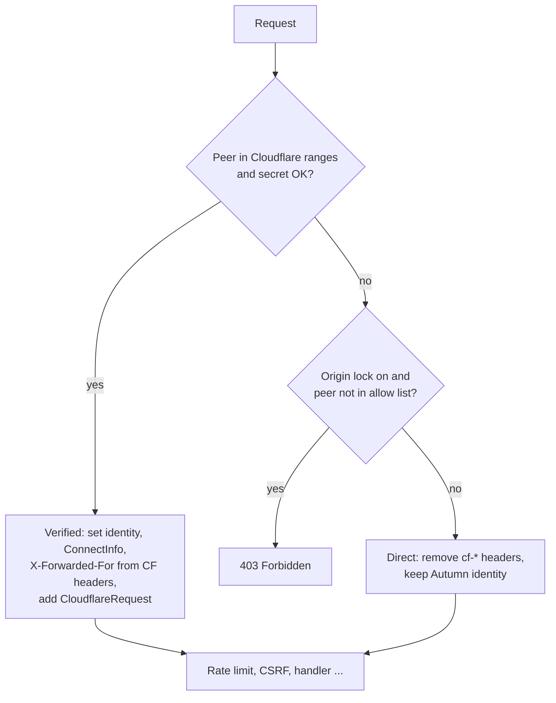

# ADR 0001: Correct the client identity in a plugin layer

- Status: Accepted
- Date: 2026-10-11

## Context

Behind Cloudflare, the TCP peer of each request is a Cloudflare edge.
Autumn features (rate limits, CSRF, bot protection, maintenance allow
lists) must use the visitor IP.

Autumn resolves the client identity in `TrustedProxiesLayer` from
`[security.trusted_proxies]`. A range list with the Cloudflare ranges is
not safe. A Worker request comes from a Cloudflare IP. Autumn skips it
and uses the next `X-Forwarded-For` entry, which the caller controls.

Cloudflare always overwrites `CF-Connecting-IP`. This header is the
correct source when the peer is a Cloudflare edge.

## Decision

The plugin adds one Tower layer with `AppBuilder::layer`. For each
request, the layer:

1. Gets the peer IP: the socket peer, or the IP that Autumn resolved
   (`PeerSource::Resolved`). It converts IPv4-mapped IPv6 to IPv4.
2. Decides `Verified`, `Direct`, or `Reject` (pure function):
   - `Verified`: the peer is in a Cloudflare range, and the shared
     secret matches (if configured).
   - `Reject`: the origin lock is on, and the peer is not `Verified`
     and not in the allow list.
   - `Direct`: all other cases.
3. Removes the shared-secret header.
4. `Verified`: sets `ResolvedClientIdentity.addr` and `.scheme` from the
   Cloudflare headers. Sets `ConnectInfo` and `X-Forwarded-For` to the
   visitor IP, and `X-Forwarded-Proto` to the scheme. Removes
   `X-Real-IP`. Adds a `CloudflareRequest` extension. The rate limiter
   resolves the IP again from the peer and `X-Forwarded-For`, so these
   values must also be the visitor IP.
5. `Direct`: removes all `cf-*` headers and `true-client-ip`.
6. `Reject`: returns `403`.

## Consequences

Good:

- No change to `autumn-web`.
- Every Autumn feature inside the user layers uses the visitor IP. This
  includes features that resolve the IP again, such as the rate limiter.
- Handlers that read `ConnectInfo` get the visitor IP.
  `CloudflareRequest::edge_ip` gives the edge IP.
- The pure decision is small. Verus proves its rules.

Bad:

- The access log, metrics, and tenancy run outside user layers. They
  show the identity from `[security.trusted_proxies]`. The README tells
  users how to configure it for logs.
- The built-in range list can become old. `refresh_ranges` fixes this.
